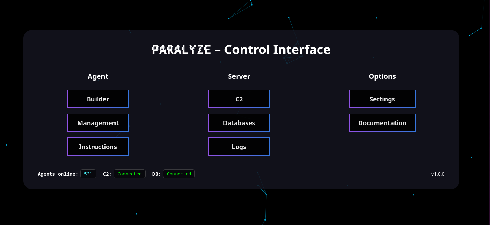

# Paralyze Project
This little project i made to study the behaviour and possibilities of botnets while deepen my C++ knowledge, especially in how to
build a command and control client-server architecture using the boost library. ***The purpose is strictly educational and not meant to be used for harmfull operations.***
This project can be used for testing your own
infrastructure reslilience against botnet attacks,
how to detect disguised network traffic or simply
understand the mechanics of a C2-agent architecture.
For any further references please check out the [technical documentation](docs/technical-documentation.md).

> This project is unfinished and currently no further development is planned.

## General concept
The Paralyze Bot as its core consitsts of just the control module. Its purpose is to fetch instructions and tools from the C2 server as administer other included modules.
To avoid detection the paralyze bot architecture disguises communication as valid `TLS` encrypted API network traffic. The C2 server mimics an Apache webserver with common API
endpoints to classify instructions.
 
To manage bots and instructions two different backend systems are used. The C2 server saves newly assigned bots into a MariaDB SQL database. Each of them is mapped to a uuid and a JWT which is sent as identifier every time the bot connects to the C2. If a bot requests an instruction the server looks up the JWT matching the one in the database and gets the connected uuid. This uuid is referred to a specified json instruction in mongodb which is sent to the bot. The bot parses this json instruction and executes the selected module including the specified parameters. 

The `server.py` is a web server written in javascript that can be used to manage C2 configurations at a graphical level. 

## Skills and knowledge i improved during this project
    - Botnet behavior
    - Evasion techniques
    - C++ 
    - PlantUML
    - PKI infrastructure
    - JSON
    - JWT
    - PEM files
    - Javascript
    - Database management
    - Modular designing
    - C2 architectur 

### C++
#### Boost Library
    - asynchronus operations
    - ssl context
    - beast library for HTTP

#### CMake build process
    - integrating conan package manager
    - conanfiles
    - integrating SBOM generation using CycloneDX
    - bash build scripts
    - CMakeLists.txt
    - CMakeDeps
    - CMakeToolchain

#### Miscellaneous
    - Polymorphism
    - Interface classes
    - mongocxx
    - mariadb
    - Singleton classes
    - Proper logging management
    - File management 
